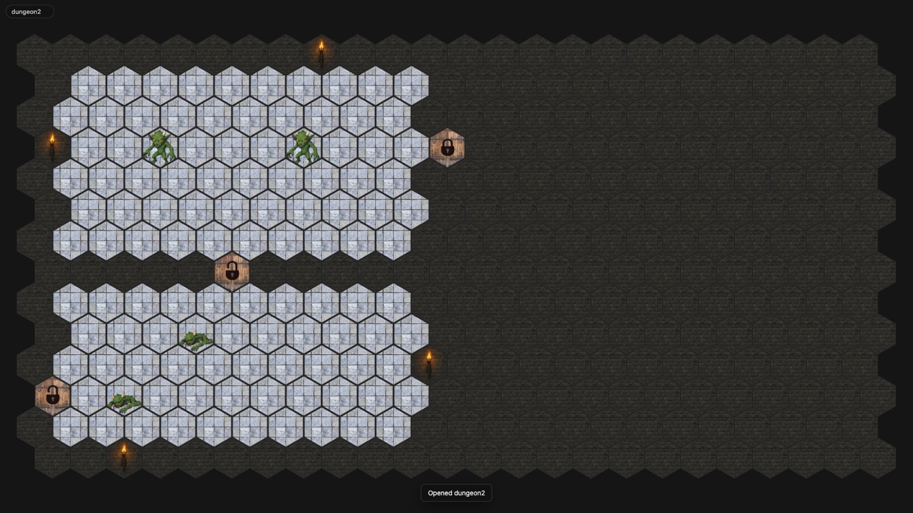
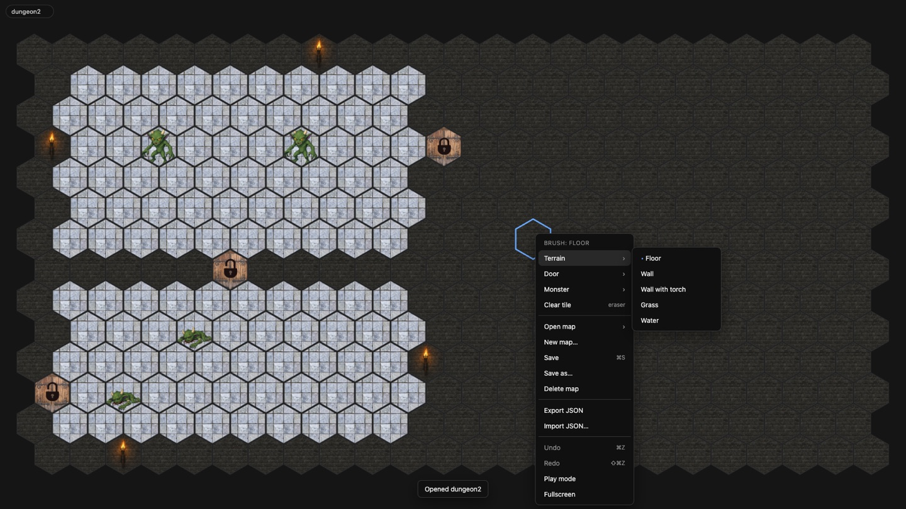
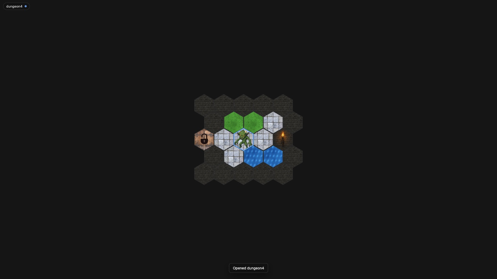

# D&D Map Editor

A hex-grid battle map editor for a TV lying flat on the table. The map is on the screen,
the miniatures stand on it. Walls, floors, doors and monsters are digital tiles you paint
with the mouse; maps are stored as JSON files in `maps/` through a tiny local server.



## Quick start

```sh
npm install     # once; installs Cypress for the tests, the app itself has no dependencies
npm start       # serves the editor and the map library at http://127.0.0.1:8420/
```

Open the URL in Chrome on the machine connected to the TV, press **Fullscreen** in the
right-click menu, and you are ready to play. `?map=<name>` in the URL opens a map directly,
for example `http://127.0.0.1:8420/?map=dungeon1`.

The hex size is calibrated so one hex matches a 1-inch miniature base on a 40-inch 1080p TV.
Larger maps shrink to fit the screen; smaller ones stay at that size.

## Controls

Everything is in the right-click menu. Right-click on a hex to edit that hex; the choice you
make also becomes the current **brush**, which left click then paints.



| Action | How |
| --- | --- |
| Paint terrain | Left click, or hold and drag |
| Place a door or monster | Pick it from the menu, then left click on hexes |
| Cycle a door (locked → closed → open) or monster (alive → injured → dead) | Left click it again with the same brush |
| Remove a monster or door | Menu → *Clear tile*, or the *Remove* entries |
| Undo / redo | ⌘Z / ⇧⌘Z (Ctrl on Windows and Linux) |
| Save | ⌘S, or menu → *Save* |
| Close the menu | Esc, or click anywhere |

**Play mode** (menu → *Play mode*) hides the hover ring, cursor and name badge and disables
left-click painting, so a nudge from a figurine cannot edit the map. Right-click still works,
so the DM can open a door or mark a monster injured mid-combat.



## Map library

- **Open map** lists every `maps/*.json` on the server.
- **New map…** asks for a name, size (up to 80×80) and fill terrain.
- **Save** writes the open map back; **Save as…** stores it under a new name and asks before overwriting.
- **Delete map** removes the file; the map stays open until you close it, so a mistake is one *Save* away from being undone.
- **Export / Import JSON** moves maps between machines or backs them up. Version 1 files from the previous release import and are migrated on the fly.

Unsaved changes are kept in the browser, so an accidental reload or tab close does not lose
work. A blue dot in the name badge means the map differs from the saved file.

## Map file format

```json
{
  "version": 2,
  "name": "dungeon4",
  "rows": 5,
  "cols": 5,
  "cells": [
    { "terrain": "wall" },
    { "terrain": "floor", "object": { "type": "door", "state": "locked" } },
    { "terrain": "floor", "token": { "type": "monster", "state": "alive" } }
  ]
}
```

`cells` is row-major, `rows × cols` long, in odd-r offset coordinates (odd rows shift half a
hex to the right). Each cell has a terrain and optionally one object (door) and one token
(monster). Terrain is kept underneath, so removing a monster reveals the floor it stood on.

Terrain ids: `floor`, `wall`, `wall_torch`, `grass`, `water`.

## Adding tile art

Tiles are declared in [src/tiles.js](src/tiles.js) and the images live in `images/`. Add an
entry and a square PNG and the menu, renderer, file validation and import all pick it up.
Textures are drawn scaled to the hex and clipped, so any square image works; 256 px is plenty.
`grass.png` and `water.png` are generated placeholders. Door and monster art has a stone floor
baked in, so they cover the terrain below them completely.

## Server

[server.mjs](server.mjs) has no dependencies and only listens on localhost.

| Method | Path | Purpose |
| --- | --- | --- |
| GET | `/api/maps` | List maps: name, size, last modified |
| GET | `/api/maps/:name` | Load a map |
| PUT | `/api/maps/:name` | Save a map (body: map JSON) |
| DELETE | `/api/maps/:name` | Delete a map |

Environment: `PORT` (default 8420), `MAPS_DIR` (default `./maps`), `HOST` (default 127.0.0.1).
Names may contain letters, digits, `-` and `_`.

## Development

```sh
npm test            # Cypress, headless Chrome
npm run test:open   # Cypress runner
```

The test config starts its own server on port 8421 against a temporary copy of `maps/`, so
specs save and delete freely. Specs live in `cypress/e2e/`; `screens.cy.js` writes 1080p
screenshots of every map and UI state to `cypress/screenshots/` for visual review.

Cypress is launched through `scripts/cypress.mjs` rather than `npx cypress` because VS Code
terminals export `ELECTRON_RUN_AS_NODE=1`, which stops the Cypress binary from opening a browser.

Layout:

```
index.html, styles.css   page shell
src/main.js              app wiring: state, input, save/open flows
src/model.js             map document, brushes, v1 → v2 migration (pure functions)
src/hex.js               hex geometry and layout
src/renderer.js          canvas drawing with per-size sprite cache
src/menu.js              context menu built from the tile catalog
src/storage.js           server client, JSON export/import, localStorage draft
src/tiles.js             tile catalog
server.mjs               static files + map API
maps/                    your map library
```

## License

Apache License 2.0. See [LICENSE](LICENSE).
